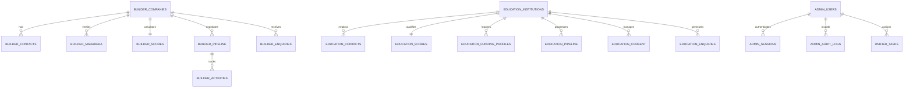

# AVANI LOAN SERVICES — UNIFIED PORTAL SYSTEM ARCHITECTURE
## DATA SEPARATION SPECIFICATION & DATABASE SCHEMAS

### 1. ABSOLUTE DATA SEPARATION GUARANTEE
The AVANI LOAN SERVICES Unified Business Growth Portal operates two strictly isolated business engines:
1. **Module A — Maharashtra Residential Builder Partnership Management** (`ALS-BLD-*`)
2. **Module B — India Education Institutional Funding Management** (`ALS-EDU-*`)

#### Separation Invariants:
- **No Shared Records:** Builder records, MahaRERA data, and developer pipelines never share database tables, schemas, or foreign keys with Educational institutions, trusts, or school funding pipelines.
- **Prefix Isolation:** All Primary Keys and Foreign Keys strictly follow domain-prefixed namespaces:
  - Builders: `ALS-BLD-*`, `ALS-BCON-*`, `ALS-BRERA-*`, `ALS-BDEAL-*`, `ALS-BACT-*`, `ALS-ENQ-BLD-*`
  - Education: `ALS-EDU-*`, `ALS-ECON-*`, `ALS-EFUND-*`, `ALS-EDEAL-*`, `ALS-ECONS-*`, `ALS-ENQ-EDU-*`
- **Zero Cross-Contamination:** No records, tokens, or credentials from AVANI AGRO FOODS or OMNIVA are admitted.

---

### 2. RELATIONAL DATABASE SCHEMAS

#### MODULE A: BUILDER PARTNERSHIP TABLES
1. `builder_companies`
   - `builder_id` (VARCHAR PK, e.g. `ALS-BLD-MH-MUM-001`)
   - `company_name` (VARCHAR NOT NULL)
   - `legal_entity_name` (VARCHAR)
   - `corporate_website` (VARCHAR)
   - `registered_office_address` (TEXT)
   - `city` (VARCHAR NOT NULL)
   - `state` (VARCHAR DEFAULT 'Maharashtra')
   - `official_telephone` (VARCHAR)
   - `official_email` (VARCHAR)
   - `contact_page_url` (VARCHAR)
   - `whatsapp_channel` (VARCHAR)
   - `whatsapp_classification` (VARCHAR)
   - `company_category` (VARCHAR)
   - `residential_project_count` (INTEGER DEFAULT 1)
   - `maharera_reg_numbers` (JSON ARRAY)
   - `project_names` (JSON ARRAY)
   - `project_locations` (JSON ARRAY)
   - `project_status` (VARCHAR)
   - `evidence_urls` (JSON ARRAY)
   - `last_verification_date` (DATE)
   - `verification_status` (VARCHAR)
   - `research_confidence` (DECIMAL)
   - `qualification_score` (DECIMAL)
   - `outreach_readiness` (VARCHAR)
   - `created_at` (TIMESTAMP)
   - `updated_at` (TIMESTAMP)

2. `builder_contacts`
   - `contact_id` (VARCHAR PK, e.g. `ALS-BCON-001`)
   - `builder_id` (VARCHAR FK -> builder_companies.builder_id)
   - `full_name` (VARCHAR NOT NULL)
   - `designation` (VARCHAR NOT NULL)
   - `department` (VARCHAR)
   - `contact_classification` (CHAR: A, B, C, D)
   - `official_phone` (VARCHAR)
   - `mobile_phone` (VARCHAR)
   - `official_email` (VARCHAR)
   - `linkedin_url` (VARCHAR)
   - `verification_source` (VARCHAR)
   - `verification_status` (VARCHAR)
   - `is_primary_decision_maker` (BOOLEAN)
   - `created_at` (TIMESTAMP)

3. `builder_maharera`
   - `rera_id` (VARCHAR PK, e.g. `ALS-BRERA-001`)
   - `builder_id` (VARCHAR FK -> builder_companies.builder_id)
   - `registration_number` (VARCHAR NOT NULL)
   - `project_name` (VARCHAR NOT NULL)
   - `promoter_legal_name` (VARCHAR NOT NULL)
   - `project_location` (VARCHAR)
   - `rera_status` (VARCHAR)
   - `match_classification` (VARCHAR: 'VERIFIED MATCH', 'VALID NUMBER — WRONG PROMOTER', 'PROJECT STATUS NOT CONFIRMED')
   - `proposed_completion_date` (DATE)
   - `revised_completion_date` (DATE)
   - `source_url` (VARCHAR)
   - `verified_at` (DATE)

4. `builder_pipeline`
   - `deal_id` (VARCHAR PK, e.g. `ALS-BDEAL-001`)
   - `builder_id` (VARCHAR FK -> builder_companies.builder_id)
   - `stage` (ENUM 1..19)
   - `stage_name` (VARCHAR)
   - `estimated_annual_disbursement` (DECIMAL)
   - `commission_rate` (DECIMAL)
   - `assigned_to` (VARCHAR FK -> admin_users.user_id)
   - `probability_pct` (INTEGER)
   - `last_contact_date` (DATE)
   - `next_followup_date` (DATE)
   - `status` (VARCHAR: Active, Won, Lost, Hold)
   - `notes` (TEXT)
   - `updated_at` (TIMESTAMP)

5. `builder_activities`
   - `activity_id` (VARCHAR PK, e.g. `ALS-BACT-001`)
   - `builder_id` (VARCHAR FK -> builder_companies.builder_id)
   - `deal_id` (VARCHAR FK -> builder_pipeline.deal_id)
   - `activity_type` (ENUM: 'Activity A — Company contact confirmation', 'Activity B — Partnership introduction', 'Activity C — Formal partnership proposal', 'Discovery Meeting', 'Agreement Discussion')
   - `channel` (ENUM: Phone, Email, In-Person, WhatsApp, Letter)
   - `scheduled_at` (TIMESTAMP)
   - `completed_at` (TIMESTAMP)
   - `performed_by` (VARCHAR FK -> admin_users.user_id)
   - `status` (ENUM: Planned, Completed, Rescheduled, Cancelled)
   - `outcome_notes` (TEXT)

6. `builder_enquiries`
   - `enquiry_id` (VARCHAR PK, e.g. `ALS-ENQ-BLD-001`)
   - `company_name` (VARCHAR NOT NULL)
   - `contact_person` (VARCHAR NOT NULL)
   - `designation` (VARCHAR NOT NULL)
   - `official_email` (VARCHAR NOT NULL)
   - `business_telephone` (VARCHAR NOT NULL)
   - `city` (VARCHAR NOT NULL)
   - `website` (VARCHAR)
   - `residential_project_count` (INTEGER)
   - `partnership_interest` (VARCHAR)
   - `preferred_discussion_time` (VARCHAR)
   - `enquiry_description` (TEXT)
   - `privacy_acknowledgement` (BOOLEAN NOT NULL)
   - `marketing_opt_in` (BOOLEAN DEFAULT FALSE)
   - `crm_lead_created` (BOOLEAN DEFAULT TRUE)
   - `status` (VARCHAR: New, Under Review, Contacted, Converted, Disqualified)
   - `created_at` (TIMESTAMP)

---

#### MODULE B: EDUCATION INSTITUTIONAL FUNDING TABLES
1. `education_institutions`
   - `institution_id` (VARCHAR PK, e.g. `ALS-EDU-MH-MUM-001`)
   - `institution_name` (VARCHAR NOT NULL)
   - `institution_category` (VARCHAR NOT NULL)
   - `subcategory` (VARCHAR)
   - `board_affiliation` (VARCHAR)
   - `ownership_type` (VARCHAR)
   - `parent_trust_society` (VARCHAR)
   - `registration_details` (VARCHAR)
   - `year_established` (INTEGER)
   - `number_of_branches` (INTEGER DEFAULT 1)
   - `student_capacity` (INTEGER)
   - `approx_enrolment` (INTEGER)
   - `website` (VARCHAR)
   - `official_email` (VARCHAR)
   - `official_telephone` (VARCHAR)
   - `complete_address` (TEXT)
   - `city` (VARCHAR NOT NULL)
   - `district` (VARCHAR)
   - `state` (VARCHAR NOT NULL)
   - `pin_code` (VARCHAR)
   - `potential_funding_requirement` (VARCHAR)
   - `funding_category` (VARCHAR: '₹5 crore–₹10 crore', etc.)
   - `funding_purpose` (TEXT)
   - `lead_priority_tier` (VARCHAR: 'A+', 'A', 'B', 'C')
   - `qualification_score` (DECIMAL)
   - `verification_status` (VARCHAR)
   - `last_verification_date` (DATE)
   - `created_at` (TIMESTAMP)

2. `education_contacts`
   - `contact_id` (VARCHAR PK, e.g. `ALS-ECON-001`)
   - `institution_id` (VARCHAR FK -> education_institutions.institution_id)
   - `full_name` (VARCHAR NOT NULL)
   - `designation` (VARCHAR NOT NULL)
   - `role_type` (VARCHAR: 'Founder', 'Managing Trustee', 'Director', 'Chairman', 'Finance Head', 'Principal')
   - `professional_phone` (VARCHAR)
   - `professional_email` (VARCHAR)
   - `public_whatsapp` (VARCHAR)
   - `linkedin_profile` (VARCHAR)
   - `contact_source_url` (VARCHAR)
   - `is_primary_decision_maker` (BOOLEAN)
   - `verification_status` (VARCHAR)

3. `education_funding_profiles`
   - `profile_id` (VARCHAR PK, e.g. `ALS-EFUND-001`)
   - `institution_id` (VARCHAR FK -> education_institutions.institution_id)
   - `funding_categories` (JSON ARRAY of eligible products from the 12 categories)
   - `estimated_amount` (DECIMAL)
   - `preferred_structure` (ENUM: Secured, Unsecured, Hybrid, Loan Against Property)
   - `eligible_lenders` (JSON ARRAY)
   - `financials_readiness` (VARCHAR)

4. `education_pipeline`
   - `deal_id` (VARCHAR PK, e.g. `ALS-EDEAL-001`)
   - `institution_id` (VARCHAR FK -> education_institutions.institution_id)
   - `stage` (ENUM 1..24)
   - `stage_name` (VARCHAR)
   - `funding_requested` (DECIMAL)
   - `sanctioned_amount` (DECIMAL)
   - `disbursed_amount` (DECIMAL)
   - `assigned_to` (VARCHAR FK -> admin_users.user_id)
   - `lender_name` (VARCHAR)
   - `sanction_date` (DATE)
   - `disbursement_date` (DATE)
   - `status` (VARCHAR: Active, Sanctioned, Disbursed, Dropped, Disqualified)
   - `notes` (TEXT)
   - `updated_at` (TIMESTAMP)

5. `education_consent_records`
   - `consent_id` (VARCHAR PK, e.g. `ALS-ECONS-001`)
   - `institution_id` (VARCHAR FK -> education_institutions.institution_id)
   - `contact_id` (VARCHAR FK -> education_contacts.contact_id)
   - `channel` (ENUM: Email, WhatsApp, Phone)
   - `consent_status` (ENUM: Granted, Pending_Request, Denied, Revoked, Opted_Out)
   - `opt_in_timestamp` (TIMESTAMP)
   - `opt_out_timestamp` (TIMESTAMP)
   - `cadence_step` (INTEGER: 0, 1, 2, 3, 4)
   - `next_eligible_date` (DATE)
   - `suppression_reason` (VARCHAR)

6. `education_enquiries`
   - `enquiry_id` (VARCHAR PK, e.g. `ALS-ENQ-EDU-001`)
   - `institution_name` (VARCHAR NOT NULL)
   - `institution_category` (VARCHAR NOT NULL)
   - `legal_entity` (VARCHAR)
   - `contact_person` (VARCHAR NOT NULL)
   - `designation` (VARCHAR NOT NULL)
   - `official_email` (VARCHAR NOT NULL)
   - `telephone` (VARCHAR NOT NULL)
   - `city` (VARCHAR NOT NULL)
   - `state` (VARCHAR NOT NULL)
   - `website` (VARCHAR)
   - `funding_requirement` (VARCHAR)
   - `estimated_amount` (DECIMAL)
   - `funding_purpose` (VARCHAR)
   - `secured_unsecured_preference` (VARCHAR)
   - `existing_loans_detail` (TEXT)
   - `preferred_contact_time` (VARCHAR)
   - `enquiry_description` (TEXT)
   - `privacy_acknowledgement` (BOOLEAN NOT NULL)
   - `email_opt_in` (BOOLEAN DEFAULT FALSE)
   - `whatsapp_opt_in` (BOOLEAN DEFAULT FALSE)
   - `crm_lead_created` (BOOLEAN DEFAULT TRUE)
   - `status` (VARCHAR: New, Under Review, In Contact, Sanctioned, Disqualified)
   - `created_at` (TIMESTAMP)

---

#### SHARED CONTROL & SECURITY TABLES
1. `admin_users`
   - `user_id` (VARCHAR PK)
   - `username` (VARCHAR UNIQUE NOT NULL)
   - `email` (VARCHAR UNIQUE NOT NULL)
   - `password_hash` (VARCHAR NOT NULL)
   - `role` (ENUM: 'Super Administrator', 'Administrator', 'Research Manager', 'Sales Manager', 'Sales Executive', 'Read-Only Analyst')
   - `must_change_password` (BOOLEAN DEFAULT TRUE)
   - `failed_login_attempts` (INTEGER DEFAULT 0)
   - `lockout_until` (TIMESTAMP NULL)
   - `is_active` (BOOLEAN DEFAULT TRUE)
   - `created_at` (TIMESTAMP)
   - `last_login` (TIMESTAMP)

2. `admin_audit_logs`
   - `log_id` (VARCHAR PK)
   - `user_id` (VARCHAR FK -> admin_users.user_id)
   - `module` (ENUM: 'BUILDER', 'EDUCATION', 'SYSTEM', 'AUTOMATION', 'ENQUIRY')
   - `action` (VARCHAR NOT NULL)
   - `details` (JSON)
   - `ip_address` (VARCHAR)
   - `user_agent` (VARCHAR)
   - `timestamp` (TIMESTAMP DEFAULT CURRENT_TIMESTAMP)

3. `system_automation_state`
   - `state_id` (VARCHAR PK DEFAULT 'GLOBAL_CONFIG')
   - `stop_active` (BOOLEAN DEFAULT FALSE)
   - `stop_triggered_by` (VARCHAR)
   - `stop_triggered_at` (TIMESTAMP)
   - `stop_reason` (TEXT)
   - `email_marketing_active` (BOOLEAN DEFAULT TRUE)
   - `whatsapp_marketing_active` (BOOLEAN DEFAULT TRUE)
   - `auto_followups_active` (BOOLEAN DEFAULT TRUE)
   - `inbound_enquiries_active` (BOOLEAN DEFAULT TRUE)
   - `last_sync_timestamp` (TIMESTAMP)

4. `unified_tasks`
   - `task_id` (VARCHAR PK)
   - `module` (VARCHAR: 'BUILDER' or 'EDUCATION')
   - `related_id` (VARCHAR: builder_id, institution_id, enquiry_id)
   - `task_title` (VARCHAR NOT NULL)
   - `task_type` (VARCHAR: 'Follow-up Call', 'Contact Confirmation', 'Document Verification', 'Send Proposal', 'Lender Sanction Meeting')
   - `due_date` (DATE NOT NULL)
   - `priority` (VARCHAR: High, Medium, Low)
   - `status` (VARCHAR: Pending, Completed, Overdue, Cancelled)
   - `assigned_to` (VARCHAR FK -> admin_users.user_id)
