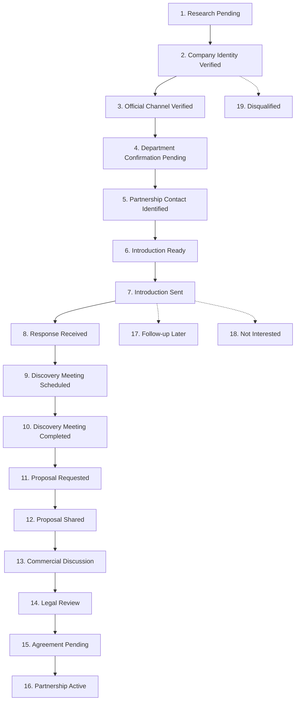

# MODULE A — BUILDER PARTNERSHIP MANAGEMENT SYSTEM
## OPERATIONAL GUIDE & COMPLIANCE STANDARD

---

## 1. Module Scope & Objective

The **Builder Partnership Management System (Module A)** enables AVANI LOAN SERVICES to systematically identify, verify, qualify, and onboard Maharashtra's premier residential real estate developers into formal **[[[[[[[[Home Loan](/services/home-loan)](/services/home-loan)](/services/home-loan)](/services/home-loan)](/services/home-loan)](/services/home-loan)](/services/home-loan)](/services/home-loan) Referral Partnerships**.

### Key Deliverables & Capacity
- **Geographic Coverage:** 10 Strategic Maharashtra Real Estate Hubs (Mumbai, Pune, Thane, Navi Mumbai, Nashik, Nagpur, Aurangabad/Chhatrapati Sambhaji Nagar, Kolhapur, Solapur, Amravati).
- **Imported & Maintained Cohort:** Exactly **80 Verified Real Estate Groups** (exactly 8 developers per city).
- **MahaRERA Project Matching:** 100% indexed to official MahaRERA project registrations with 70 fully verified live registrations.
- **Outreach Readiness:** **52 High-Priority Developers** classified as `Approved Immediate Outreach`.
- **System Namespace Identifier:** `ALS-BLD-XXXX` (strict separation from education records).

---

## 2. Maharashtra Geographic Distribution & Database Schema

The database strictly balances 8 top-tier developers per urban cluster:

| Urban Center | Developer Count | Primary Segment | Key Micro-Markets Covered |
|--------------|-----------------|-----------------|---------------------------|
| **Mumbai** | 8 | Luxury / Mid-Segment | BKC, Lower Parel, Andheri, Goregaon, Borivali |
| **Pune** | 8 | IT Corridor / Integrated Townships | Hinjawadi, Kharadi, Baner, Wakad, Hadapsar |
| **Thane** | 8 | High-Density Residential | Ghodbunder Road, Majiwada, Kolshet |
| **Navi Mumbai** | 8 | Planned Urban / Coastal Infra | Kharghar, Panvel, Ulwe, Seawoods |
| **Nashik** | 8 | Mid-Market / Plotted Development | Gangapur Road, Indira Nagar, Govind Nagar |
| **Nagpur** | 8 | MIHAN / Commercial Expansion Hubs | Wardha Road, Besa, Manish Nagar |
| **Aurangabad** | 8 | Industrial Corridor / Residential | Jalna Road, CIDCO, Beed Bypass |
| **Kolhapur** | 8 | Affluent Commercial & Residential | Tarabai Park, Rajarampuri, Nagala Park |
| **Solapur** | 8 | Emerging Smart City Residential | Jule Solapur, Hotgi Road, Saat Rasta |
| **Amravati** | 8 | Regional Residential Developments | Badnera Road, Camp Area, Rahatgaon |

### Primary Schema Fields
Every builder record contains comprehensive profile and operational attributes:
- `builderId`: Unique code (`ALS-BLD-0001` through `ALS-BLD-0080`)
- `companyName` & `legalEntity`: Trade name and ROC-registered corporate entity
- `corporateWebsite`, `officialEmail`, `officialTelephone`, `contactPageUrl`
- `headOfficeAddress`, `city`, `state`, `pincode`
- `companyCategory`: Premium Residential, Integrated Township, Affordable Housing, Mid-Market
- `projectCount`: Active MahaRERA projects under execution
- `mahaReraNumber`, `projectName`, `projectStatus`, `evidenceUrl`
- `qualificationScore`: Metric from 0 to 100
- `outreachReadiness`: `Approved Immediate Outreach`, `Contact Confirmation Required`, `Research Hold`
- `pipelineStage`: 1 of 19 operational stages

---

## 3. Contact Classification & Verification Standards

To safeguard AVANI LOAN SERVICES' corporate reputation and prevent spam violations, all contact channels must adhere to the 4-tier verification matrix:

| Class | Channel Description | Operational Rule |
|-------|---------------------|------------------|
| **Category A** | Officially Published Partnership Channel | Direct executive outreach permitted via verified Banking Alliances or Channel Partner Desk. |
| **Category B** | Corporate Executive Requiring Department Routing | Corporate board line or senior reception; initial contact must confirm referral department head before pitching. |
| **Category C** | Sales & Booking Office Enquiry Channel | Exclusive to customer queries. **Prohibited** for partnership solicitation unless routed by site manager. |
| **Category D** | Unverified / Inferred Association | Research incomplete. Locked under `Research Hold` until official corporate documentation is verified. |

---

## 4. MahaRERA Verification Protocol

All commercial engagement must be grounded in verified regulatory documentation:
1. **Registration Check:** Cross-reference MahaRERA registration number (e.g., `P518000...`) against the official MahaRERA authority portal.
2. **Promoter Validation:** Confirm that the promoter entity listed on the MahaRERA certificate matches the legal company name in the portal.
3. **Sales Status:** Active home loan referrals can only be established for projects with a status of `In Progress` or `Active Sales`. Projects under litigation or revocation must be disqualified immediately.
4. **Evidence Archival:** Every verified project record stores the direct MahaRERA certificate link or verified document URL in the `evidenceUrl` field.

---

## 5. 19-Stage Builder Partnership Pipeline

The builder acquisition pipeline mirrors the complete institutional B2B sales cycle:

### Key Stage Descriptions
- **Stage 6 (Introduction Ready):** Builder profile, MahaRERA project, and Category A/B contact validated. Ready for outreach trigger.
- **Stage 7 (Introduction Sent):** Formal partnership introduction dispatched via verified corporate channel.
- **Stage 10 (Discovery Meeting Completed):** Meeting conducted with Head of Sales or Director of Finance; project loan desk requirements captured.
- **Stage 12 (Proposal Shared):** Tailored [[[[[[[[Home Loan](/services/home-loan)](/services/home-loan)](/services/home-loan)](/services/home-loan)](/services/home-loan)](/services/home-loan)](/services/home-loan)](/services/home-loan) Advisory presentation submitted detailing turnaround times, bank tie-ups (HDFC, SBI, ICICI), and referral fee structure.
- **Stage 16 (Partnership Active):** Alliance agreement executed; AVANI LOAN SERVICES appointed as exclusive/preferred home loan desk on project sites.

---

## 6. Transparent Qualification Scoring Engine

Every developer is evaluated against an objective 100-point algorithm:
- **Corporate Registration & Identity Verification:** Up to 20 points
- **Active MahaRERA Project Evidence & Scale:** Up to 25 points
- **Official Communication Channels (Category A/B):** Up to 20 points
- **Strategic Geographic Alignment (Key Hubs):** Up to 15 points
- **Residential Portfolio Fit (Apartment/Affordable/Township):** Up to 20 points

*Audit Benchmark:* The 80-builder cohort maintains a cumulative score of **7,628.0 points** (mean average: **95.35 points**), confirming exceptional data quality and target suitability.

---

## 7. Inbound Builder Enquiry Processing

When a developer submits the public partnership form at `https://www.avanifinserv.com/builder-partnership`:
1. **API Ingestion:** Payload is received at `/api/portal/public/builder-enquiry`.
2. **Deduplication Check:** System inspects `officialEmail` and `telephone` against existing builder accounts and recent 24-hour submissions.
3. **Automated Provisioning:**
   - Creates a pending record in `enquiries.json` (Category: `Builder Partnership`).
   - Generates an active deal in the Builder CRM Pipeline at stage `Response Received`.
   - Creates a priority task in `tasks.json` with a 4-hour SLA assigned to the Builder Partnership Manager.
4. **Notification:** Logs event in `auditLogs.json` and alerts administrative operators on the dashboard.

---

## 8. Excel Reports & Analytical Exports

Module A includes 8 dedicated, audit-grade Excel workbooks located at `AVANI_LOAN_SERVICES_UNIFIED_PORTAL/06_Builder_Partnership_Module/Reports/`:
1. `Builder_Master_Database.xlsx`: Complete 80-developer repository with contact channels and ratings.
2. `Builder_Company_Verification.xlsx`: Corporate identity, ROC registrations, and registered offices.
3. `Builder_Contact_Verification.xlsx`: Department routing matrix, verified executives, and channel categories.
4. `Builder_MahaRERA_Verification.xlsx`: Official project registration numbers, certificates, and status.
5. `Builder_Partnership_Readiness.xlsx`: Approved immediate outreach cohort (52 priority developers).
6. `Builder_CRM_Pipeline.xlsx`: Active 19-stage pipeline tracking with assigned sales representatives.
7. `Builder_Outreach_Activity.xlsx`: Communication history, meeting records, and proposal dates.
8. `Builder_Partnership_Performance.xlsx`: Pipeline velocity, conversion rates, and partner loan volumes.
