# MODULE B — EDUCATION INSTITUTIONAL FUNDING MANAGEMENT SYSTEM
## OPERATIONAL GUIDE & COMPLIANCE STANDARD

---

## 1. Module Scope & Objective

The **Education Institutional Funding Management System (Module B)** enables AVANI LOAN SERVICES to identify, evaluate, advise, and arrange structured debt financing for accredited educational institutions across India.

### Key Deliverables & Capacity
- **Geographic Coverage:** Pan-India (18 States and Union Territories including Maharashtra, Karnataka, Tamil Nadu, Delhi NCR, Gujarat, Telangana, Uttar Pradesh, Rajasthan, West Bengal).
- **Imported & Maintained Cohort:** Exactly **80 Verified Educational Institutions and Trusts**.
- **Priority A+ High-Yield Prospects:** **52 Institutions** scoring $\ge 85$ with confirmed multi-crore capital expenditure requirements.
- **Detailed Schema:** 65 comprehensive fields spanning institutional credentials, trustee decision-makers, collateral profile, and credit readiness.
- **Credit Product Spectrum:** 12 structured funding categories tailored to educational institutions.
- **Consent & Compliance:** Strict DPDP Act alignment; 80 pre-consent records maintained with opt-in/opt-out tracking.
- **System Namespace Identifier:** `ALS-EDU-XXXX` (strict separation from builder records).

---

## 2. Institutional Diversity & State Distribution

The 80-institution master cohort encompasses the full hierarchy of private and autonomous education providers in India:

| Category | Institution Type | Representative Examples | Typical Capital Requirement |
|----------|------------------|-------------------------|-----------------------------|
| **K-12 Schools** | CBSE / ICSE / IB World Schools | Modern High Schools, International Academies | ₹5 Cr – ₹25 Cr (Campus expansion, smart labs, sports complexes) |
| **Higher Education** | Engineering & Technology Colleges | Autonomous Institutes of Technology | ₹15 Cr – ₹75 Cr (R&D centres, hostel blocks, NBA accreditation) |
| **Medical & Health** | Medical, Dental & Nursing Colleges | Multi-speciality Teaching Hospitals | ₹50 Cr – ₹200 Cr (Medical equipment, hospital bed expansion) |
| **Educational Trusts** | Multi-Campus Charitable Trusts | Public Charitable Educational Trusts | ₹25 Cr – ₹150 Cr (New campus acquisition, trust debt consolidation) |
| **Professional Institutes**| Management, Law & Design Institutes | Premier Business & Law Schools | ₹10 Cr – ₹40 Cr (Executive centres, modern auditoriums) |
| **Coaching & Training** | NEET/JEE & Civil Services Academies | Established Regional Coaching Chains | ₹3 Cr – ₹15 Cr (Branch rollouts, digital recording studios) |

---

## 3. The 12 Institutional Funding Categories

Institutional credit facilities are structured under 12 specialized loan products:

1. **School Infrastructure Finance:** Construction of academic blocks, auditoriums, athletic complexes, and STEM laboratories.
2. **College Infrastructure Finance:** Multi-storey academic facilities, high-capacity student hostels, and campus infrastructure.
3. **Education Institution Expansion Finance:** Greenfield and brownfield campus development across new regional hubs.
4. **Land and Building Finance:** Strategic acquisition of adjacent parcels for regulatory compliance and physical campus growth.
5. **Construction Finance:** Staged drawdown developer-style construction facilities for major institutional buildings.
6. **Renovation & Modernization Finance:** Upgradation of legacy heritage buildings, HVAC systems, and digital classroom retrofits.
7. **Equipment & Laboratory Finance:** High-cost scientific, biomedical, computing, and vocational laboratory machinery.
8. **Working Capital Finance:** Bridging cash flow cycles between bi-annual fee collection tranches and operational payroll.
9. **Loan Against Property (LAP):** Liquidity unlocked from free-hold educational land and commercial campus assets.
10. **Secured Institutional Funding:** Term debt backed by fixed deposits, trustee guarantees, and mortgage of immovable institutional assets.
11. **Unsecured Business Funding:** Short-to-medium term debt based on cash-flow surplus and student enrolment trajectory.
12. **Educational Trust Funding:** Structured long-term debt facilities extended directly to registered public charitable trusts.

---

## 4. Priority A+ Scoring Model (52 Benchmark Prospects)

Institutional prospects are prioritized based on an objective, weighted multi-factor scoring algorithm:

$$\text{Total Score} = S_{\text{scale}} + S_{\text{accredit}} + S_{\text{financial}} + S_{\text{decision}} + S_{\text{project}}$$

- **Institutional Scale & Enrolment (Max 25 Pts):** Student body $> 2,500$ students, multi-campus presence, tuition fee resilience.
- **Accreditation & Standing (Max 20 Pts):** NAAC A/A+ rating, NBA accreditation, NIRF ranking, CBSE/ICSE board standing.
- **Financial Health & Collateral (Max 25 Pts):** Debt service coverage ratio (DSCR $> 1.5$), positive EBIDTA surplus, clear property titles.
- **Decision-Maker Accessibility (Max 15 Pts):** Verified Chairman, Managing Trustee, or Chief Financial Officer direct channels.
- **Imminent Capex / Project Readiness (Max 15 Pts):** Active master plan approvals, DPR (Detailed Project Report) availability.

*Benchmark Qualification:* **52 Institutions** achieved a score $\ge 85$ and are designated as `Priority A+ High-Yield Prospects`.

---

## 5. 24-Stage Institutional Funding CRM Pipeline

The institutional credit underwriting and disbursement cycle requires a 24-stage pipeline:

```mermaid
flowchart TD
    E1[1. Prospect Identified] --> E2[2. Institution Profile Verified]
    E2 --> E3[3. Decision Maker Identified]
    E3 --> E4[4. Pre-Outreach Review]
    E4 --> E5[5. Permission Confirmed]
    E5 --> E6[6. Outreach Initiated]
    E6 --> E7[7. Response Received]
    E7 --> E8[8. Initial Discovery Call]
    E8 --> E9[9. Funding Need Identified]
    E9 --> E10[10. Documents Requested]
    E10 --> E11[11. Preliminary Documents Received]
    E11 --> E12[12. Financial Review Underway]
    E12 --> E13[13. Feasibility Analysis Complete]
    E13 --> E14[14. Funding Structure Proposed]
    E14 --> E15[15. In-Person Meeting Scheduled]
    E15 --> E16[16. Trustee Presentation Completed]
    E16 --> E17[17. Formal Application Submitted]
    E17 --> E18[18. Credit Committee Evaluation]
    E18 --> E19[19. Sanction Letter Issued]
    E19 --> E20[20. Commercial Terms Accepted]
    E20 --> E21[21. Legal & Title Due Diligence]
    E21 --> E22[22. Loan Agreement Executed]
    E22 --> E23[23. Disbursement In Progress]
    E23 --> E24[24. Fully Disbursed & Active]
```

### Stage Milestones
- **Stage 5 (Permission Confirmed):** Verified DPDP consent on file. Unsolicited outreach strictly blocked prior to this milestone.
- **Stage 11 (Preliminary Documents Received):** Trust deed, 3 years audited ITR/balance sheets, and land title documents ingested.
- **Stage 18 (Credit Committee Evaluation):** Joint advisory presentation submitted to partner NBFCs/Banks (e.g., Tata Capital, HDFC Bank, Axis Bank, Piramal).
- **Stage 24 (Fully Disbursed & Active):** Loan funds credited to trust escrow; advisory success fee realized by AVANI LOAN SERVICES.

---

## 6. DPDP Compliance & Consent Protocols

AVANI LOAN SERVICES enforces complete compliance with India's **Digital Personal Data Protection (DPDP) Act, 2023**:
1. **Consent Registry:** All 80 records feature explicit consent tracking (`opt_in`, `pending`, `withdrawn`).
2. **Pre-Consent State:** Records are imported with `consent_status: "pending_verification"`. Direct promotional campaigns cannot execute without opt-in recording.
3. **Cadence Enforcement:**
   - Maximum 1 introduction per 14-day cycle.
   - Immediate halt upon receiving a "Not Interested" or "Unsubscribe" communication.
   - Right to Erasure: Trust request for data deletion executes within 24 hours across active caches.
4. **Audit Trail:** Every consent transition logs operator username, IP address, and timestamp in `auditLogs.json`.

---

## 7. Inbound Education Enquiry Processing

Institutional leaders submitting inquiries via `https://www.avanifinserv.com/institutional-funding`:
1. **API Endpoint:** Handled via `/api/portal/public/education-enquiry`.
2. **Payload Verification:** Validates `institutionName`, `trustName`, `fundingCategory`, `ticketSize`, and official contact details.
3. **CRM Deal & Task Creation:**
   - Creates an inbound entry in `enquiries.json` (Category: `Institutional Funding`).
   - Automatically maps enquiry into Education Pipeline Stage 7 (`Response Received`).
   - Assigns a high-priority discovery task to the Education Finance Specialist with a 2-hour response SLA.
4. **Consent Recording:** Inbound web submission constitutes affirmative consent (`opt_in`) and updates `consent.json` automatically.

---

## 8. Excel Reports & Analytical Exports

Module B includes 8 audit-grade Excel workbooks located at `AVANI_LOAN_SERVICES_UNIFIED_PORTAL/07_Education_Funding_Module/Reports/`:
1. `Education_Institution_Master.xlsx`: Master ledger of 80 institutions with contact details and campus data.
2. `Education_Aplus_Prospects.xlsx`: Dedicated register of the 52 Priority A+ high-yield opportunities.
3. `Education_CRM_Pipeline.xlsx`: 24-stage credit pipeline with loan amounts, stages, and assigned officers.
4. `Education_Contact_Verification.xlsx`: Verified trustees, directors, and finance officers.
5. `Education_Consent_Report.xlsx`: Comprehensive DPDP consent audit ledger.
6. `Education_Lead_Scoring.xlsx`: Granular score breakdowns across scale, accreditation, and capex readiness.
7. `Education_Funding_Enquiry_Report.xlsx`: Log of all inbound portal enquiries and conversion milestones.
8. `Education_Outreach_Activity.xlsx`: Communication ledger, discovery calls, and advisory progress.
