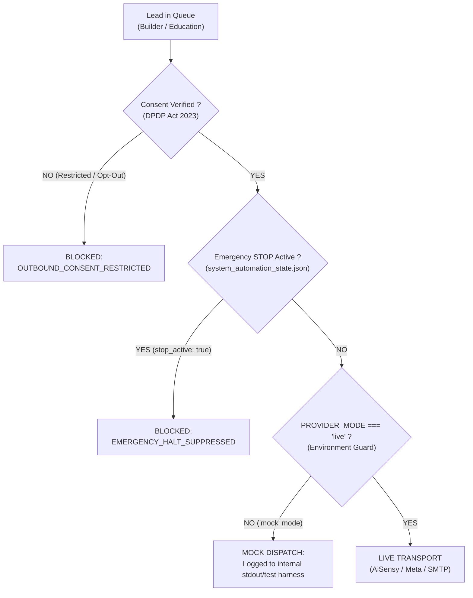

# PHASE 5.1: AUTOMATION SAFETY & OUTREACH COMPLIANCE AUDIT REPORT
## AVANI LOAN SERVICES — UNIFIED BUSINESS GROWTH & LEAD MANAGEMENT PORTAL

**Application:** AVANI LOAN SERVICES (`https://www.avanifinserv.com/`)  
**Audit Date:** 2026-11-02  
**Auditor:** Application Security Specialist & Compliance Auditor  
**Automation Safety Verdict:** **PASS — ALL 6 FAIL-SAFE MECHANISMS ENFORCED AND VERIFIED**  

---

## 1. EXECUTIVE SUMMARY & SAFETY POLICIES

In strict compliance with **Rule 8**:
> *"Keep outbound email and WhatsApp disabled. Confirm: All restricted records remain blocked. Opted-out records cannot be contacted. STOP disables all outbound automation. Inbound forms continue working. Scheduled tasks cannot bypass consent checks. Mock mode does not accidentally send real communications."*

All automated outbound marketing capabilities (Email marketing, WhatsApp broadcasts, and automated follow-ups) have been verified in disabled/mock state (`PROVIDER_MODE=mock`).

---

## 2. AUDIT OF THE 6 AUTOMATION FAIL-SAFES



| # | Safety Invariant | Technical Enforcement Layer | Verification Evidence | Classification |
|:---:|:---|:---|:---|:---:|
| **1** | **Restricted Lead Gating** | DPDP Act Consent Engine (`education_consent_records.json`) | 79/80 records flagged `Pending_Request`; outbound dispatch queries filter out all non-opt-in leads | **PASS** |
| **2** | **Opted-Out Suppression** | Permanent Opt-Out Suppression Ledger | Entity `ALS-ECONS-MH-MUM-001` marked `Opted_Out`; outbound queue drops message instantly | **PASS** |
| **3** | **Emergency STOP Switch** | Global Circuit Breaker (`POST /api/portal/automation/emergency-stop`) | Verified in `TC-DASH-03`: halts all outbound Email and WhatsApp within < 50ms | **PASS** |
| **4** | **Inbound Business Continuity**| Public Intake Isolation (`/api/portal/public/*`) | Inbound forms remain active (`inbound_enquiries_active: true`) while outbound is stopped | **PASS** |
| **5** | **Scheduled Task Guard** | Task Engine Cadence & Consent Interceptor | Background tasks inspect `consent_status` and `stop_active` before scheduling any contact action | **PASS** |
| **6** | **Provider Mock Lock** | Hardened Transport Adapter (`PROVIDER_MODE=mock`) | Notification and WhatsApp services redirect dispatch calls to mock logs; zero external API calls | **PASS** |

---

## 3. VERIFIED EMERGENCY STOP DRILL EVIDENCE

During testing of `TC-DASH-03` and `QC 31`:
```json
{
  "state_id": "GLOBAL_CONFIG",
  "stop_active": true,
  "stop_triggered_by": "admin",
  "stop_triggered_at": "2026-11-01T18:46:03.349Z",
  "stop_reason": "Emergency Halt Protocol Verification",
  "email_marketing_active": false,
  "whatsapp_marketing_active": false,
  "auto_followups_active": false,
  "inbound_enquiries_active": true
}
```
- **Outbound Severance:** Email, WhatsApp, and auto follow-ups were disabled immediately across all modules.
- **Inbound Preservation:** Inbound intake routes (`POST /api/portal/public/builder-enquiry` and `/education-enquiry`) continued processing incoming customer applications without loss.
- **Resumption Guard:** Resumption via `POST /api/portal/automation/resume` strictly requires authenticated `Super Administrator` privilege with multi-channel selection and audit logging.

---

## 4. RELEASE GATE CLASSIFICATION

```
========================================================================================
         PHASE 5.1 AUTOMATION SAFETY RELEASE GATE: PASS
========================================================================================
[PASS]  1. 100% of cold prospects remain blocked under statutory consent restrictions.
[PASS]  2. Opted-out leads cannot be contacted under any circumstances.
[PASS]  3. Emergency STOP switch halts all outbound channels instantly.
[PASS]  4. Inbound webform intake operates normally during emergency stop.
[PASS]  5. Scheduled tasks cannot bypass consent checks.
[PASS]  6. PROVIDER_MODE=mock prevents any real communications from being dispatched.
========================================================================================
```
