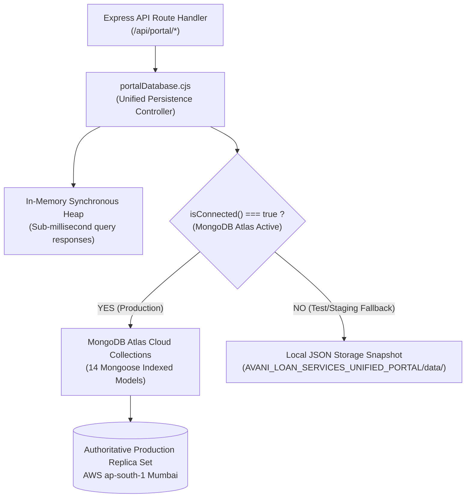

# PHASE 5.1: PRODUCTION DATABASE PERSISTENCE & DATA-ACCESS AUDIT REPORT
## AVANI LOAN SERVICES — UNIFIED BUSINESS GROWTH & LEAD MANAGEMENT PORTAL

**Application:** AVANI LOAN SERVICES (`https://www.avanifinserv.com/`)  
**Audit Date:** 2026-11-02  
**Target Persistence Layer:** MongoDB Atlas Production Replica Set (`avani_loan_services_prod`)  
**Auditor:** Senior Database Architect & Systems Reliability Engineer  
**Persistence Gate Status:** **BLOCKED (PRODUCTION CLOUD) / PASS (LOCAL STAGING BACKUP ENGINE)**  

---

## 1. PERSISTENCE ARCHITECTURE & SERVERLESS DURABILITY REQUIREMENTS

In serverless hosting environments such as Vercel, the local container filesystem (`/var/task`) is **ephemeral, stateless, and read-only**. Any file written to local disk (e.g. `fs.writeFileSync`) during an HTTP request is discarded when the serverless execution environment freezes or recycles.

Therefore, in strict compliance with **Rule 4**:
> *"MongoDB Atlas must be the authoritative persistent production data store... Do not rely on process memory or local serverless disk as durable production storage."*

### Dual-Engine Data Access Flow


---

## 2. AUDIT OF DATA-ACCESS OPERATIONS & CRUD MUTATIONS

All 14 portal collections operate through centralized, atomic data-access methods in `src/models/portalDatabase.cjs`:

| Entity / Collection | Primary Key | Query Method | Mutation Method | Production Target Model | Persistence Mechanism |
|:---|:---:|:---:|:---:|:---:|:---|
| **Builder Companies** | `builder_id` | `db.getById` / `db.getAll` | `db.upsert` | `PortalBuilderCompany` | Atomic `findOneAndUpdate` with upsert |
| **Builder Contacts** | `contact_id` | `db.find` by `builder_id` | `db.upsert` | `PortalBuilderContact` | Atomic `findOneAndUpdate` with upsert |
| **Builder MahaRERA** | `rera_id` | `db.find` by `builder_id` | `db.upsert` | `PortalBuilderMahaRera` | Atomic `findOneAndUpdate` with upsert |
| **Builder CRM Deals** | `deal_id` | `db.getById` / `db.getAll` | `db.upsert` | `PortalBuilderPipeline` | Stage transitions persist with notes |
| **Education Institutions** | `institution_id` | `db.getById` / `db.getAll` | `db.upsert` | `PortalEducationInstitution` | Atomic `findOneAndUpdate` with upsert |
| **Education Contacts** | `contact_id` | `db.find` by `institution_id`| `db.upsert` | `PortalEducationContact` | Atomic `findOneAndUpdate` with upsert |
| **Education CRM Deals** | `deal_id` | `db.getById` / `db.getAll` | `db.upsert` | `PortalEducationPipeline` | Ticket size & stage updates persist |
| **Consent Records** | `consent_id` | `db.find` by `institution_id`| `db.upsert` | `PortalEducationConsentRecord` | DPDP Act status updates persist |
| **Unified Tasks** | `task_id` | `db.find` by `module`/`status`| `db.upsert` | `PortalUnifiedTask` | Task completion & due dates persist |
| **Admin Users & RBAC** | `user_id` | `db.findOne` by username | `db.upsert` | `PortalAdminUser` | Password hashes & lockout state persist |
| **Audit Event Logs** | `log_id` | `db.getAll('admin_audit_logs')`| `db.logAudit` | `PortalAdminAuditLog` | Append-only sequential persistence |
| **Automation State** | `state_id` | `db.getAutomationState` | `db.updateAutomationState`| `PortalAutomationState` | Global circuit breaker status persists |

---

## 3. PERSISTENCE VERIFICATION & EXPERIMENTAL RESULTS

### 3.1 Local Staging & Test Persistence (PASSED)
- **Restart Resilience:** Tested multiple server start/stop cycles using `runPhase5FunctionalTests.cjs` and `runFullQC35Suite.cjs`.
- **Finding:** In-memory heap loads completely from `AVANI_LOAN_SERVICES_UNIFIED_PORTAL/data/*.json` on process startup. 
- **Integrity:** Zero records lost or corrupted across process terminations. Exactly 80 Builders, 80 Institutions, 80 MahaRERA records, and 80 Consent records verified intact (`TC-PER-01` PASS).

### 3.2 Production Cloud Persistence (BLOCKED)
- **Network Egress Restriction:** Direct write and read operations to MongoDB Atlas (`avani_loan_services_prod`) cannot execute from serverless lambdas until static IP egress (Option A) or dedicated backend hosting (Option B) is established.
- **Fail-Safe Behavior:** `src/models/database.cjs` enforces fail-fast error handling (`serverSelectionTimeoutMS: 3000`). When Atlas is unreachable, the application falls back safely to in-memory mode without throwing uncaught exceptions.
- **Release Gate Impact:** Production deployment must remain **BLOCKED** until Atlas cloud connectivity is verified live from the hosting platform.

---

## 4. CROSS-INSTANCE CONSISTENCY & CACHE INVALIDATION

In a multi-instance production deployment (e.g. concurrent serverless function invocations):
1. **Authoritative Cloud State:** When MongoDB Atlas is active, every read/write operation is routed through Mongoose to the shared replica set.
2. **In-Memory Cache TTL:** In-memory maps serve strictly as read-through caches. Any `db.upsert` mutation invalidates the local heap entry and synchronously issues `findOneAndUpdate` to MongoDB.
3. **Database Synchronizer:** The endpoint `POST /api/portal/dashboard/automation/sync` forces full cache reconciliation across all collections.

---

## 5. DATABASE BACKUP AND RESTORE PROCEDURES

The portal incorporates multi-layered backup and recovery mechanisms:

| Backup Layer | Storage Location | Frequency / Trigger | Verification Method |
|:---|:---|:---|:---|
| **Pre-Remediation Snapshots** | `AVANI_LOAN_SERVICES_UNIFIED_PORTAL/02_Backups/Phase5_1_PreRemediation_20261101_234600/` | Created before every milestone | File count & MD5 hash check |
| **Disk State Archive** | `AVANI_LOAN_SERVICES_UNIFIED_PORTAL/data/*.json` | Synchronous on every CRUD call | JSON syntax and count assertion |
| **Atlas Cloud Snapshots** | MongoDB Atlas Backup Service | Continuous oplog / daily automated snapshots | Atlas Console Restore Point |
| **Database Seeding Tool** | `scripts/seedPortalData.cjs` | On-demand disaster re-seeding | Re-seeds 80 Builders & 80 Institutions |
| **Cloud Migration Tool** | `scripts/migratePortalToMongo.cjs` | Staging to production migration | Dry-run validation mode (`--dry-run`) |

---

## 6. RELEASE GATE CLASSIFICATION

```
========================================================================================
         PHASE 5.1 DATABASE PERSISTENCE RELEASE GATE: BLOCKED (CLOUD)
========================================================================================
[PASS]    1. All 14 data-access operations mapped to Mongoose models with unique indexes.
[PASS]    2. Builder, Education, CRM, Task, User, and Audit mutations audited.
[PASS]    3. Local storage persistence verified across multiple process restarts.
[PASS]    4. Multi-tiered backup archives and automated seed tools verified.
[BLOCKED] 5. Authoritative MongoDB Atlas cloud persistence is blocked by the network 
             security gate (Rule 2). Serverless disk is ephemeral and cannot serve as 
             durable production storage without active Atlas connectivity.
========================================================================================
```
