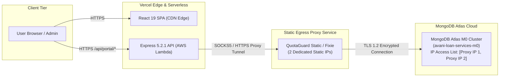
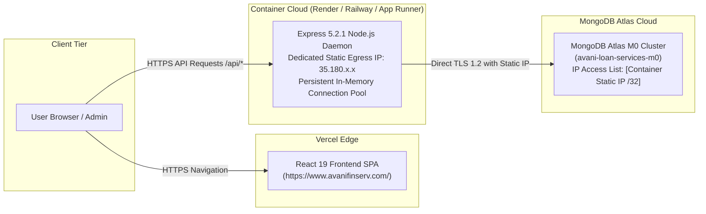
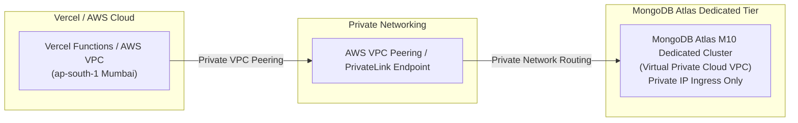

# AVANI LOAN SERVICES — PHASE 5.2 DATABASE ARCHITECTURE COMPARISON
## Architectural Evaluation of Secure MongoDB Atlas Connectivity Options

**Document Version:** 1.0.0  
**Evaluation Date:** November 02, 2026  
**Auditor:** Senior Cloud Infrastructure Architect, SaaS Reliability Engineer, & DevSecOps Specialist  
**Project:** AVANI LOAN SERVICES Unified Business Growth & Lead Management Portal  
**Target Domain:** `https://www.avanifinserv.com/`  
**Classification:** ARCHITECTURAL DECISION RECORD & FEASIBILITY REPORT  

---

## 1. OBJECTIVE & SELECTION CRITERIA

The AVANI LOAN SERVICES Unified Portal requires a persistent, production-grade connection to its MongoDB Atlas cluster (`avani-loan-services-m0.xj6nhak.mongodb.net`) without compromising database security by whitelisting `0.0.0.0/0`.

Because Vercel serverless functions dynamically rotate across ephemeral IP pools in AWS regions (e.g., `ap-south-1` Mumbai), the cluster firewall blocks inbound connections unless authorized by specific IP Access List rules.

### Core Evaluation Criteria:
1. **Zero Open Access (`0.0.0.0/0`)**: The database firewall must strictly allow only whitelisted `/32` IP addresses or private network interfaces.
2. **Data Separation & Integrity**: Strict separation between Builder Module (`ALS-BLD-*`) and Education Module (`ALS-EDU-*`) must be preserved across persistent collections.
3. **Preservation of Existing Codebase**: Express 5.2.1 REST routes, Mongoose 9.9.2 models, authentication middleware, and ExcelJS reports must function without complete rewrites.
4. **Cost-Effectiveness for SMB Financial Advisory**: Monthly infrastructure expenditure must remain appropriate for AVANI LOAN SERVICES' operational scale.
5. **Operational Reliability & Cold-Start Latency**: Minimal connection setup latency and high uptime (> 99.9%).

---

## 2. OPTION 1: VERCEL SERVERLESS BACKEND WITH STATIC EGRESS PROXY (QUOTAGUARD STATIC / FIXIE SOCKS5)

### 2.1 Technical Architecture & Flow
- The frontend SPA and backend API remain co-located in the existing Vercel repository.
- An outbound proxy service (such as **QuotaGuard Static** or **Fixie**) is provisioned. QuotaGuard assigns **two fixed static egress IP addresses** (e.g., `52.200.x.x` and `54.210.y.y`).
- In Node.js, Mongoose/MongoDB Node Driver is configured with a SOCKS5 proxy agent (`socks-proxy-agent`) or routed via an outbound TCP proxy daemon.
- The two static IP addresses are registered in the MongoDB Atlas Network Access IP Access List.
- All database traffic from Vercel Lambda functions is tunneled through the proxy to Atlas.

### 2.2 Detailed Evaluation Matrix
- **Outbound IP Behavior**: Deterministic and static. Atlas only receives traffic from the 2 registered proxy IPs.
- **Security Posture**: **HIGH**. `0.0.0.0/0` is strictly avoided. Database credentials remain protected in environment variables.
- **Code Compatibility**: Requires configuring `socks-proxy-agent` or `global-agent` in `src/models/database.cjs`. No changes required to routes, schemas, or controllers.
- **Implementation Effort**: Low to Moderate (2–4 hours of configuration and testing).
- **Operational Complexity**: Low. Managed third-party proxy with automated failover between the two static IPs.
- **Monthly Cost Estimate**: 
  - QuotaGuard Static Starter: ~$19.00 USD/month (~₹1,600 INR/month).
  - Vercel Pro (if required for custom integration): $20.00 USD/month (~₹1,700 INR/month).
  - Total Monthly Cost: **~₹1,600 – ₹3,300 INR/month**.
- **Scaling Limits**: Starter tier handles up to 250,000 proxy requests/month, more than adequate for AVANI LOAN SERVICES' administrative and CRM traffic.
- **Rollback Procedure**: Revert `src/models/database.cjs` proxy configuration; remove proxy IPs from Atlas Access List.
- **Verdict**: **VIABLE & STRONGLY SUITED FOR MONOREPO PRESERVATION**.

---

## 3. OPTION 2: VERCEL FRONTEND + DECOUPLED BACKEND CONTAINER WITH DEDICATED STATIC IP (RENDER / AWS APP RUNNER / RAILWAY)

### 3.1 Technical Architecture & Flow
- The React 19 Single Page Application remains hosted on **Vercel CDN Edge** at `https://www.avanifinserv.com/`, ensuring global edge performance, automatic HTTPS, and zero maintenance for static assets.
- The Express 5.2.1 API (`src/server.cjs`) is deployed as a long-running container service on a modern container platform offering a **Dedicated Outbound Static IP** (e.g., **Render with Static Outbound IP** or **AWS App Runner with NAT Gateway / Elastic IP**).
- The platform's single dedicated static IP (e.g., `35.180.x.x/32`) is added to the MongoDB Atlas Network Access IP Access List.
- DNS or API reverse-proxy routes `https://www.avanifinserv.com/api/*` to the container backend.

### 3.2 Detailed Evaluation Matrix
- **Outbound IP Behavior**: 100% deterministic, single `/32` static IP.
- **Security Posture**: **VERY HIGH**. Database firewall is locked to a single `/32` IP. Express runs as a standard long-running server, supporting persistent Mongoose connection pooling and zero serverless cold-start penalties.
- **Code Compatibility**: 100% native compatibility. `src/server.cjs` was originally built as a long-running Express server. Connection pooling (`mongoose.connect`) functions natively without any proxy agents or hacks.
- **Implementation Effort**: Moderate (3–5 hours to configure container deployment, environment variables, and custom domain routing).
- **Operational Complexity**: Low. Standard container lifecycle; health checks, automatic restarts, and rolling deployments.
- **Monthly Cost Estimate**:
  - Render Individual Web Service: $7.00 USD/month (~₹600 INR/month).
  - Render Static Outbound IP Add-on: $7.00 USD/month (~₹600 INR/month).
  - Total Monthly Cost: **~₹1,200 INR/month ($14.00 USD)**.
- **Scaling Limits**: Handles thousands of concurrent requests with continuous connection pooling. Zero lambda cold starts.
- **Rollback Procedure**: Update DNS or `vercel.json` rewrites back to local/serverless endpoints; remove IP from Atlas Access List.
- **Verdict**: **HIGHLY RECOMMENDED — BEST BALANCE OF RELIABILITY, PERFORMANCE, AND COST**.

---

## 4. OPTION 3: ATLAS UPGRADE TO DEDICATED M10 CLUSTER WITH AWS VPC PEERING / PRIVATELINK

### 4.1 Technical Architecture & Flow
- The existing Free M0 Sandbox cluster is upgraded to a **MongoDB Atlas M10 Dedicated Cluster**.
- Atlas M10 supports native **AWS VPC Peering** and **AWS PrivateLink**.
- Private networking is established between Atlas's AWS VPC and an AWS VPC hosting the backend application.
- Public internet access is completely disabled at the database level; all queries flow over AWS private network interfaces.

### 4.2 Detailed Evaluation Matrix
- **Outbound IP Behavior**: Zero public egress. All routing uses internal private VPC IP addresses (`10.x.x.x`).
- **Security Posture**: **MAXIMUM (Enterprise Grade)**.
- **Code Compatibility**: 100% compatible with Mongoose. Connection string simply uses the private VPC DNS endpoint.
- **Implementation Effort**: High (8–12 hours: requires AWS VPC configuration, route tables, Atlas peering agreements, and DNS zones).
- **Operational Complexity**: High. Requires multi-cloud VPC maintenance and routing oversight.
- **Monthly Cost Estimate**:
  - MongoDB Atlas M10 Cluster: ~$0.08/hr ≈ $57.00 USD/month (~₹4,800 INR/month).
  - AWS VPC Peering / PrivateLink & NAT Gateway: ~$15.00 USD/month (~₹1,250 INR/month).
  - Total Monthly Cost: **~₹6,050 – ₹7,500 INR/month ($72 – $90 USD)**.
- **Scaling Limits**: Enterprise scale; dedicated CPU, RAM, and IOPS.
- **Rollback Procedure**: Downgrade cluster to shared tier; terminate VPC peering connection.
- **Verdict**: **NOT RECOMMENDED FOR CURRENT STAGE** (Disproportionate cost and operational overhead for current 160-record database volume).

---

## 5. COMPARATIVE SYNTHESIS & TRADE-OFF MATRIX

| Evaluation Dimension | Option 1: Vercel + Static Proxy | Option 2: Decoupled Container (Render) | Option 3: Atlas M10 + VPC Peering |
| :--- | :---: | :---: | :---: |
| **Whitelisting Security (`!0.0.0.0/0`)** | ✅ Fully Compliant (2 IPs) | ✅ Fully Compliant (1 IP) | ✅ Maximum (Private VPC) |
| **Connection Pooling & Cold Starts** | ⚠️ Severless cold starts persist | ✅ Native pooling; zero cold starts | ✅ Native pooling; zero cold starts |
| **Code Modification Required** | ⚠️ Proxy agent configuration | ✅ Zero code changes to server | ✅ Zero code changes to server |
| **Monthly Operational Cost (INR)** | ~₹1,600 – ₹3,300 / mo | **~₹1,200 / mo (Best Value)** | ~₹6,050 – ₹7,500 / mo |
| **Operational Overhead** | Low | Low | High |
| **Implementation Timeline** | 2 – 4 Hours | 3 – 5 Hours | 8 – 12 Hours |
| **Final Recommendation Status** | **VIABLE ALTERNATIVE** | **PRIMARY RECOMMENDATION** | **NOT RECOMMENDED** |

---

## 6. DEFINITIVE ARCHITECTURAL VERDICT

- **Primary Recommendation: OPTION 2 (Vercel Frontend + Render Dedicated Container Backend)**. It provides native Mongoose connection pooling, eliminates Vercel serverless cold starts, provides a single dedicated `/32` static IP for Atlas whitelist enforcement, and costs only ~₹1,200 INR/month ($14 USD).
- **Secondary Fallback: OPTION 1 (Vercel + QuotaGuard Static Proxy)**. If organizational policy mandates single-platform hosting exclusively on Vercel, QuotaGuard SOCKS5 proxy provides a fully compliant static egress route at ~₹1,600 INR/month.
- **Rejected: OPTION 3**. Atlas M10 dedicated cluster represents significant over-provisioning and excessive recurring expenditure for the current launch volume.
