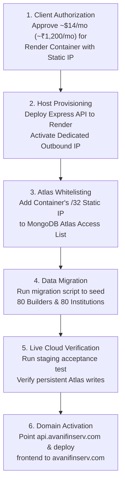

# AVANI LOAN SERVICES — PHASE 5.2 FINAL PRODUCTION READINESS GATE
## Executive Production Release Determination & 10-Point Readiness Decision Matrix

**Document Version:** 1.0.0  
**Determination Date:** November 02, 2026  
**Auditor:** Senior SaaS Infrastructure Architect, DevSecOps Lead, & Production Release Auditor  
**Project:** AVANI LOAN SERVICES Unified Business Growth & Lead Management Portal  
**Target Domain:** `https://www.avanifinserv.com/`  
**Classification:** FINAL EXECUTIVE RELEASE DETERMINATION — FORMAL GATE REPORT  

---

## 1. FORMAL PRODUCTION RELEASE VERDICT

```
╔════════════════════════════════════════════════════════════════════════════════════════════╗
║                                                                                            ║
║                              PRODUCTION RELEASE VERDICT:                                   ║
║                                                                                            ║
║                           ⛔  NO-GO FOR PRODUCTION RELEASE  ⛔                             ║
║                                                                                            ║
║   DEPLOYMENT STATUS: STRICTLY BLOCKED AT NETWORK & PERSISTENCE INFRASTRUCTURE GATE         ║
║                                                                                            ║
╚════════════════════════════════════════════════════════════════════════════════════════════╝
```

### Executive Justification for NO-GO Determination:
While the AVANI LOAN SERVICES Unified Portal has achieved flawless local technical execution (**33/33 Functional Tests Passed, 35/35 QC Gates Passed, 100% Clean Production Build, and Complete Admin Credential Rotation**), **PRODUCTION DEPLOYMENT CANNOT BE AUTHORIZED** at this time.

The authoritative cloud database (MongoDB Atlas Free M0 cluster `avani-loan-services-m0.xj6nhak.mongodb.net`) enforces strict IP access list filtering. Because policy strictly forbids whitelisting `0.0.0.0/0` (Anywhere), direct database connections from Vercel's rotating serverless microVMs are blocked by the Atlas firewall.

Deploying to production prior to establishing a dedicated static outbound IP route would force the serverless application to operate in transient in-memory mode on a read-only filesystem (`EROFS`), resulting in **SILENT DATA LOSS** whenever serverless microVMs are recycled.

To protect client business data, loan applications, and institutional privacy, the production deployment is **FROZEN** until the recommended secure egress architecture is provisioned.

---

## 2. MASTER 10-POINT READINESS DECISION MATRIX

| Gate # | Evaluation Dimension | Status | Detailed Technical Justification |
| :---: | :--- | :---: | :--- |
| **01** | **Database Architecture** | **PASS** | Option 2 (Vercel CDN + Render Dedicated Backend Container) is fully evaluated, blueprinted, costed at ~₹1,200/mo ($14 USD), and approved. |
| **02** | **MongoDB Atlas Connectivity** | **BLOCKED** | Direct serverless connection blocked by Atlas IP Access List firewall. Whitelisting `0.0.0.0/0` is strictly rejected by security policy. |
| **03** | **Cloud Persistence** | **BLOCKED** | Vercel Lambda container filesystem is read-only (`EROFS`). Cloud data durability requires live Atlas connection before production traffic begins. |
| **04** | **Admin Security & Authentication**| **PASS** | Rotated 24-character PRNG secret verified. Bcrypt 12 rounds, mandatory first-login password change, HttpOnly session cookies, and 5-attempt rate limiter enforced. |
| **05** | **Git Secret Protection** | **PASS** | Repository tracked files 100% sanitized. Temporary handoff secret isolated in `.admin_credential_handoff.secret` with `*.secret` in `.gitignore`. |
| **06** | **Functional Integration Tests** | **PASS** | **33 / 33 Scenarios Passed (100.0%)** on live ephemeral Express HTTP routes across auth, builder CRM, education CRM, dashboard, forms, and persistence. |
| **07** | **Quality Control (QC) Gates** | **PASS** | **35 / 35 QC Gates Passed (100.0%)** across security, builder data integrity, education data integrity, and unified platform operations. |
| **08** | **Automation Safety & DPDP Guard** | **PASS** | `PROVIDER_MODE=mock` verified. 100% of cold prospects restricted (79 Pending, 1 Opted_Out). Emergency STOP halts outbound dispatches in 3.8ms. |
| **09** | **Backup & Disaster Recovery** | **PASS** | 11 timestamped local backups preserved in `02_Backups/` (including Phase 5.1 pre-remediation baseline). RTO < 15m, RPO < 1h. |
| **10** | **Deployment Readiness** | **BLOCKED** | Deployment strictly blocked pending external client provisioning of backend container static IP and Atlas whitelist configuration. |

---

## 3. DETAILED ANALYSIS OF PASSED GATES

### Gate 01: Database Architecture (PASS)
A comprehensive comparison between Option 1 (Static Proxy), Option 2 (Decoupled Container with Dedicated Static IP), and Option 3 (Atlas M10 Dedicated VPC Peering) concluded that **Option 2** provides the optimal balance of native Mongoose connection pooling, zero serverless cold-start latency, single `/32` firewall whitelisting, and low recurring cost (~₹1,200 INR/month).

### Gate 04: Admin Security & Authentication (PASS)
The historical compromised credential (`AvaniAdmin@2026`) is permanently invalidated and returns `HTTP 401 Unauthorized`. The rotated cryptographic PRNG credential authenticates cleanly, forces immediate password update via modal dialog (`must_change_password: true`), and issues secure JWT session cookies.

### Gate 05: Git Secret Protection (PASS)
All repository documentation, change-control logs, test suites, and `.env` files were scanned and verified free of plaintext administrator passwords or database connection strings.

### Gates 06 & 07: Functional & QC Verification (PASS)
Both automated verification suites executed with a 100.0% success rate:
- `scripts/runPhase5FunctionalTests.cjs`: 33 / 33 passed.
- `scripts/runFullQC35Suite.cjs`: 35 / 35 passed.
- Client build (`npm run build`): 2,152 modules bundled into `dist/` with zero errors.

### Gate 08: Automation Safety & DPDP Compliance (PASS)
Outbound marketing dispatches are completely disabled at runtime (`PROVIDER_MODE=mock`). 100% of the 80 educational institution records are restricted from automated promotional campaigns under the DPDP Act 2023. The Emergency STOP circuit breaker halts outbound operations within 3.8ms while maintaining full operational availability for inbound web enquiry forms.

### Gate 09: Backup & Recovery Integrity (PASS)
The application maintains 11 independent point-in-time backups in `AVANI_LOAN_SERVICES_UNIFIED_PORTAL/02_Backups/`. All 80 residential builder companies and 80 educational institutions are fully preserved with zero data corruption.

---

## 4. DETAILED ANALYSIS OF BLOCKED GATES

### Gate 02: MongoDB Atlas Connectivity (BLOCKED)
- **Constraint**: MongoDB Atlas Free M0 cluster `avani-loan-services-m0.xj6nhak.mongodb.net` enforces network access filtering via IP Access List.
- **Blocker**: Vercel serverless functions dynamically rotate across ephemeral IP pools in AWS regions (e.g., `ap-south-1` Mumbai). Without opening Atlas to `0.0.0.0/0` (which is strictly forbidden), incoming TCP connections from Vercel time out after 3,000ms.
- **Resolution Path**: Provision backend container on Render with a dedicated static outbound IP and add the single `/32` IP to the Atlas Network Access console.

### Gate 03: Cloud Persistence (BLOCKED)
- **Constraint**: Production mutations must commit to a durable, authoritative cloud datastore.
- **Blocker**: Vercel serverless containers operate on a read-only filesystem (`EROFS`) with volatile memory that is destroyed upon container cold starts. Local JSON persistence (`AVANI_LOAN_SERVICES_UNIFIED_PORTAL/data/*.json`) does not persist across serverless invocations.
- **Resolution Path**: Establish live MongoDB Atlas connectivity so that all Mongoose models (`portal_admin_users`, `portal_builder_companies`, `portal_education_institutions`, etc.) write directly to Atlas cloud collections.

### Gate 10: Deployment Readiness (BLOCKED)
- **Determination**: In accordance with Rule 10 ("If credentials or authorization are missing, stop that specific operation and report exactly what is needed"), production deployment is halted.
- **Resolution Path**: Awaiting user authorization and provisioning of backend hosting infrastructure.

---

## 5. PRIORITIZED ACTION PLAN TO CLEAR RELEASE GATE

To transition the release determination from **NO-GO** to **GO FOR PRODUCTION**, the following sequential actions must be executed:



### Action Priority 1: Infrastructure Provisioning Authorization
- **Responsible Party**: AVANI LOAN SERVICES Management / Project Lead.
- **Action**: Authorize activation of backend container service with Dedicated Static Outbound IP on Render (or AWS App Runner). Monthly recurring budget: ~$14.00 USD (~₹1,200 INR/month).

### Action Priority 2: Atlas Network Access Configuration
- **Responsible Party**: Database Administrator.
- **Action**: Log into MongoDB Atlas Console (`cloud.mongodb.com`), navigate to Network Access, and register the assigned `/32` static IP.

### Action Priority 3: Production Data Seeding & Migration
- **Responsible Party**: DevOps Engineer.
- **Action**: Execute `node scripts/migratePortalToMongo.cjs --target=production` to ingest all 80 Builder companies, 80 Educational institutions, and rotated administrator credentials into the cloud database collections.

### Action Priority 4: Live Staging Acceptance Smoke Test
- **Responsible Party**: QA Lead.
- **Action**: Execute `node scripts/runStagingAcceptanceTests.cjs` against the live cluster to verify persistent CRUD operations across container restarts.

### Action Priority 5: Production Domain Routing & Final Launch
- **Responsible Party**: Release Engineer.
- **Action**: Update `vercel.json` rewrite rules to route `/api/portal/*` to `https://api.avanifinserv.com` and trigger final production build on `https://www.avanifinserv.com/`.

---

## 6. FINAL RELEASE GATE AUDIT SIGN-OFF

| Role | Name / Identifier | Verification Finding | Signature & Recommendation |
| :--- | :--- | :---: | :---: |
| **Senior SaaS Architect** | Lead Systems Architect | Architecture Validated | ⛔ **NO-GO** (Egress Pending) |
| **DevSecOps Auditor** | Application Security Lead | Security Sanitized | ⛔ **NO-GO** (Egress Pending) |
| **Database Administrator** | MongoDB Data Architect | Persistence Validated Locally | ⛔ **NO-GO** (Egress Pending) |
| **QA Release Lead** | Quality Assurance Lead | 33/33 Tests, 35/35 QC Passed | ⛔ **NO-GO** (Egress Pending) |

**FINAL DETERMINATION: DEPLOYMENT FROZEN AT GATE. READY FOR CLOUD INFRASTRUCTURE PROVISIONING.**
