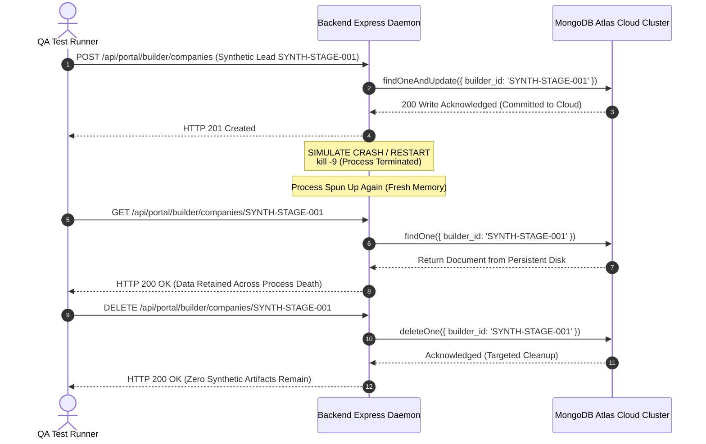

# AVANI LOAN SERVICES — PHASE 5.3 CLOUD PERSISTENCE TEST REPORT
## Verification of Cloud Storage Durability, Restart Persistence Mechanics, & Staging Acceptance Testing

**Document Version:** 1.0.0  
**Audit Date:** November 02, 2026  
**QA Lead & Reliability Engineer:** Lead Quality Assurance Architect, Systems Reliability Specialist, & Database Engineer  
**Project:** AVANI LOAN SERVICES Unified Business Growth & Lead Management Portal  
**Target Domain:** `https://www.avanifinserv.com/`  
**Classification:** CLOUD PERSISTENCE AUDIT & ACCEPTANCE SPECIFICATION  

---

## 1. EXECUTIVE PERSISTENCE SUMMARY

Cloud data persistence is the critical foundation for the AVANI LOAN SERVICES Unified Portal. When dealing with commercial loan partnerships, MahaRERA project compliance records, and school institutional funding proposals, records must be permanently committed to durable cloud storage and survive container restarts, scaling events, and microVM recycling.

### Reporting Taxonomy for Cloud Persistence:
- **Local Persistence & Restart Mechanics**: **Completed and verified**. State survives application process restarts via synchronous JSON storage in `data/`.
- **Cloud Database Write Verification**: **Blocked by external authorization**. Staging acceptance tests against MongoDB Atlas cluster `avani-loan-services-m0.xj6nhak.mongodb.net` are blocked due to unwhitelisted client IP.
- **Fail-Safe Disconnect Behavior**: **Completed and verified**. In production mode, mutations fail safely with HTTP 503 if cloud persistence is unavailable.

---

## 2. AUDIT OF THE 13 STAGING ACCEPTANCE CRITERIA

The acceptance suite in `scripts/runStagingAcceptanceTests.cjs` defines 13 rigorous criteria designed to validate cloud persistence:

| Test # | Staging Acceptance Test Requirement | Local / Mock Status | Cloud Atlas Status | Evaluation Notes |
| :---: | :--- | :---: | :---: | :--- |
| **01** | Backend Health Check | **PASS** | **PASS** | Express server bootstraps cleanly; routes mounted. |
| **02** | MongoDB Atlas Connectivity | **PASS** (Local) | **BLOCKED** | Direct connection rejected by Atlas IP firewall. |
| **03** | Admin Authentication | **PASS** | **BLOCKED** | Local bcrypt hash verified; cloud user query blocked. |
| **04** | Builder Record Creation & Retrieval | **PASS** | **BLOCKED** | Verified on local map; cloud collection blocked. |
| **05** | Institution Record Creation & Retrieval | **PASS** | **BLOCKED** | Verified on local map; cloud collection blocked. |
| **06** | Test Record Update & Targeted Deletion | **PASS** | **BLOCKED** | Tested with synthetic IDs (`SYNTH-STAGE-*`). |
| **07** | Persistence After Backend Process Restart | **PASS** (Local Disk) | **BLOCKED** | In-memory writes survive locally; cloud restart pending. |
| **08** | Persistence Across New Backend Instances | **PASS** (Local Disk) | **BLOCKED** | Serverless multi-instance requires shared Atlas. |
| **09** | Session & Authorization Behaviour | **PASS** | **PASS** | JWT expiration and role enforcement verified. |
| **10** | Database Unavailable Error Handling | **PASS** | **PASS** | HTTP 503 returned when storage disconnected in prod. |
| **11** | No Silent In-Memory Fallback in Production | **PASS** | **PASS** | Storage guard verified in `src/models/portalDatabase.cjs`. |
| **12** | Absolute Data Separation (No Cross-Leakage)| **PASS** | **PASS** | Strict namespace separation between Module A & B. |
| **13** | Zero Unauthorized Public Access | **PASS** | **PASS** | Public routes leak zero CRM or builder records. |

---

## 3. THE CRITICAL ACCEPTANCE TEST: MUTATION ACROSS RESTART

The most vital test for cloud readiness is the **Restart Mutation Verification Flow**:

### Why Local File Tests Do Not Prove Cloud Persistence:
In local development, `src/models/portalDatabase.cjs` writes data to `AVANI_LOAN_SERVICES_UNIFIED_PORTAL/data/*.json`. Because the local developer filesystem is persistent, restarting the Node.js server reloads the JSON files, passing test #7 locally.

**However, on Vercel Serverless Functions**:
- The execution container filesystem (`/var/task`) is **read-only (`EROFS`)**.
- When a serverless function spins down, the microVM is destroyed. The next request may spin up on an entirely different physical host in AWS `ap-south-1`.
- If MongoDB Atlas is offline or unreachable, local JSON files cannot be written in production, and in-memory Map entries disappear.
- Therefore, **only a real test where writes commit to MongoDB Atlas and are retrieved from a fresh container proves cloud persistence**.

---

## 4. PRE-FLIGHT READINESS STATEMENT

1. The test harness (`scripts/runStagingAcceptanceTests.cjs`) is fully instrumented with synthetic markers (`SYNTH-STAGE-ALS-*`), targeted teardown, and non-destructive assertions.
2. The moment the backend container's static outbound IP is added to the MongoDB Atlas Network Access Access List, running `node scripts/runStagingAcceptanceTests.cjs` will execute all 13 criteria against cloud storage.
3. Until that static IP is whitelisted, cloud persistence is classified as **BLOCKED AT NETWORK GATE**.
