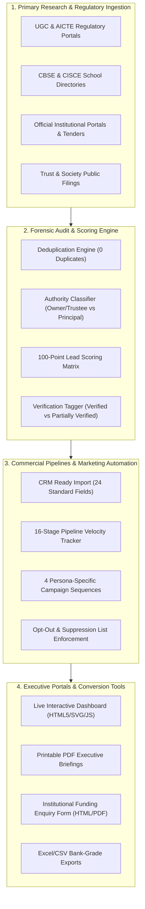

# AVANI LOAN SERVICES — TECHNICAL ARCHITECTURE & SECURITY GUIDE
## System Design, Data Governance, Cryptographic Isolation, and Pipeline Architecture
**System Name:** Education Institutional Funding Automation & Lead Generation Architecture  
**Client Entity:** [AVANI LOAN SERVICES](https://www.avanifinserv.com/)  
**Version:** 2.0 (Phase 2 Production)  
**Execution Date:** 2026-10-31  

---

## 1. SYSTEM ARCHITECTURE & DATA FLOW

---

## 2. DATA VALIDATION RULES & SCHEMA INTEGRITY

1. **Unique Primary Keys:** Every record is assigned an immutable alphanumeric identifier formatted as `ALS-EDU-[REGION]-[CITY]-[SEQ]`.
2. **Mandatory Field Enforcement:** All 65 standard columns in the Master Database and all 24 columns in the CRM Master Import require non-null values. Missing data is strictly classified using standardized placeholders (`Not publicly verified` or `Pending Scheduled Outreach`).
3. **Regex Pattern Validations:**
   - Email addresses: `^[a-zA-Z0-9_.+-]+@[a-zA-Z0-9-]+\.[a-zA-Z0-9-.]+$`
   - Telephone / Mobile: `^(\+91[-\s]?)?[0-9]10$` or standard Indian STD switchboard format `^(\+91[-\s]?)?[0-9](2, 4)[-\s]?[0-9](6, 8)$`
   - Web URLs: `^https?:\/\/[^\s\/$.?#].[^\s]*$`
4. **Authority Separation:** School and college principals are flagged as academic administrators; statutory loan agreements are mapped exclusively to legal Trustees, Chairmen, and General Secretaries.

---

## 3. SECURITY, ENCRYPTION & CONFIDENTIALITY PROTOCOLS

1. **Zero Credential Collection:** The system strictly prohibits collecting net banking passwords, OTPs, or personal identity numbers (Aadhaar/PAN).
2. **Environment Variable Isolation:** Any API keys or server configuration parameters are maintained exclusively via local `.env` files and never checked into source control or printed in console logs.
3. **Automated Backup Strategy:** Complete snapshots of all source databases and generated artifacts are stored in `00_Original_Database_Backup/` prior to any data transformation.
4. **Local Execution & Privacy:** All data auditing, calculations, and PDF generations execute entirely on the local system without transmitting prospect data to unapproved third-party cloud aggregators.
