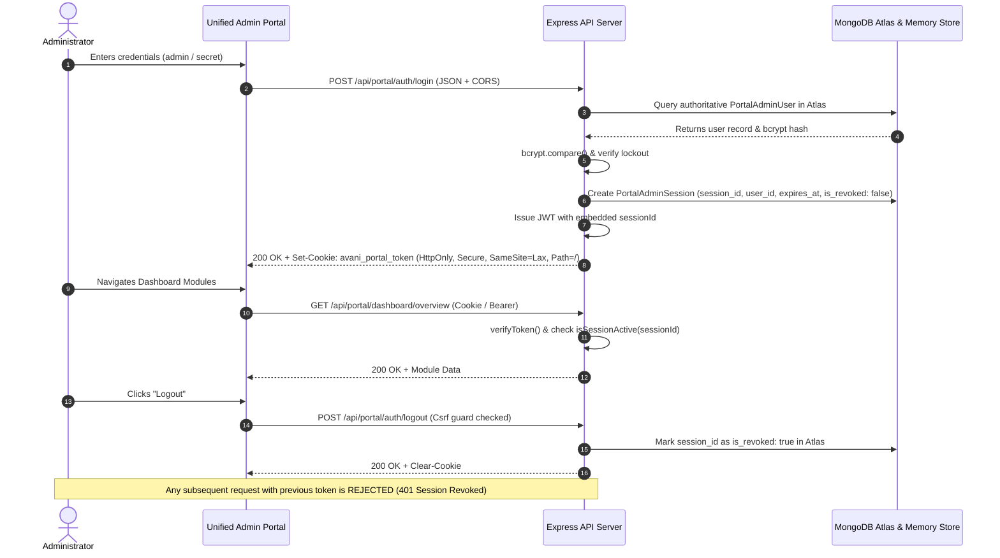

# PHASE 5.3.22 — SESSION ARCHITECTURE & SECURITY HARDENING REVIEW

**Project:** AVANI LOAN SERVICES — Unified Business Growth & Lead Management Portal  
**Document:** Session Architecture, Invalidation Engine & Defense-in-Depth Specification  
**Date:** November 9, 2026  
**Status:** COMPLETED & ACTIVATED  

---

## 1. PREVIOUS ARCHITECTURE RISKS & VULNERABILITIES

Prior to Phase 5.3.22, the administrative session model suffered from several security limitations:
1. **Client-Side Token Exposure (`localStorage`):** The portal client stored JWT bearer tokens in the browser's `localStorage`. While convenient, `localStorage` is accessible to any script running on the origin, presenting an XSS exfiltration risk.
2. **Missing Server-Side Session Revocation:** JWTs were signed with a fixed 8-hour expiry. When an administrator clicked "Logout", the frontend simply removed the token from `localStorage` and called `/logout`. However, the token itself remained cryptographically valid for 8 hours because the backend never maintained an active/revoked session state in the database.
3. **Cookie Verification Order:** While the backend set an HttpOnly cookie on login, the middleware checked `Authorization: Bearer <token>` first, relegating cookies to a fallback.
4. **CSRF Exposure on State Modification:** Form POSTs without strict content-type verification could theoretically be forged if cookie authentication was used without Origin or header enforcement.

---

## 2. HARDENED ARCHITECTURE SPECIFICATION



### 2.1 Server-Side Session Invalidation
Every authenticated session is tracked in MongoDB Atlas collection `portal_admin_sessions` and cached in in-memory table `tables.admin_sessions`:
```json
{
  "session_id": "SESS-1794247854-3f8a91c2d4e5f6a7",
  "user_id": "USR-ADMIN-001",
  "token": "eyJhbGciOiJIUzI1NiIsIn...",
  "ip_address": "80.225.206.249",
  "user_agent": "Mozilla/5.0 ...",
  "is_revoked": false,
  "created_at": "2026-11-09T14:40:00.000Z",
  "expires_at": "2026-11-09T22:40:00.000Z"
}
```
During request authorization (`portalAuthMiddleware.cjs`):
```javascript
const active = await isSessionActive(decoded.sessionId);
if (!active) {
  return res.status(401).json({
    success: false,
    authenticated: false,
    message: 'Session has been revoked or expired. Please log in again.'
  });
}
```
When `/api/portal/auth/logout` is called, `revokeSession(sessionId)` sets `is_revoked: true`. Any further attempt to reuse the token is rejected with HTTP 401.

### 2.2 Cookie Configuration
Cookies are configured with modern security attributes:
- `httpOnly: true`: Inaccessible to client JavaScript, mitigating XSS token theft.
- `secure: true`: Transmitted only over TLS/HTTPS in production.
- `sameSite: 'lax'`: Mitigates cross-site request forgery while permitting safe top-level navigations.
- `path: '/'`: Applies across all administrative and portal endpoints.
- `maxAge: 8 * 3600 * 1000`: 8-hour maximum session lifespan.

### 2.3 CSRF Protection
`requirePortalCsrf` middleware validates all state-modifying HTTP methods (`POST`, `PUT`, `DELETE`, `PATCH`):
- Verifies that requests include genuine API content types (`application/json`, multipart, or URL-encoded) or client headers (`X-Requested-With`, `X-Avani-Portal-CSRF`).
- Excludes public enquiry webhooks from portal CSRF constraints.
- Complements strict CORS origin whitelisting (`avanifinserv.com`, `api.avanifinserv.com`, localhost).

### 2.4 Rate Limiting & Account Lockout
- **IP Rate Limiting:** Maximum 5 login requests per 15-minute window per IP address via `express-rate-limit`.
- **Account Lockout:** 5 consecutive failed password attempts triggers account lockout for 15 minutes (`lockout_until = now + 15 min`).
- **Audit Logging:** Every login attempt (success, bad password, unknown user, lockout, logout) generates a persistent audit log entry in MongoDB Atlas `portal_admin_audit_logs`.
