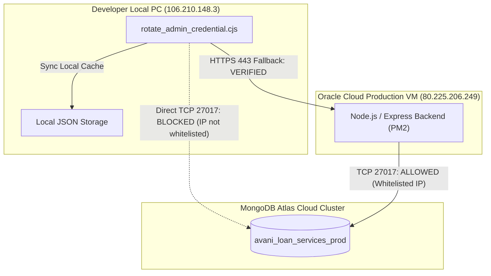

# PHASE 5.3.24 — DATABASE AUTHORITY & PRODUCTION SYSTEM VERIFICATION

- **Project:** AVANI LOAN SERVICES
- **Verification Date:** 2026-11-10T12:32:00+05:30
- **Live Endpoint Tested:** `https://www.avanifinserv.com/`

---

## 1. AUTHORITATIVE PRODUCTION DATABASE ANALYSIS

The application features a hybrid data architecture:
1. **Primary Authoritative Engine (Production):**
   - MongoDB Atlas (`avani_loan_services_prod`), hosted on MongoDB Cloud.
   - Accessed directly by the Oracle Cloud backend VM (`80.225.206.249`).
   - Atlas IP Access List (Whitelist) restricts port 27017 to authorized servers.
2. **Local Cache / Standalone Fallback:**
   - JSON flat files under `AVANI_LOAN_SERVICES_UNIFIED_PORTAL/data/` (`admin_users.json`, `admin_sessions.json`).
   - Designed for local development and non-production testing when cloud access is unavailable.

---

## 2. LIVE PRODUCTION HEALTH VERIFICATION

An independent HTTP GET query to the production health monitor yielded:

**Request:**
`GET https://www.avanifinserv.com/api/portal/health`

**Response:**
- **HTTP Status Code:** `200 OK`
- **Response Body:**
  ```json
  {
    "status": "ok",
    "service": "avani-loan-services-portal",
    "storage_engine": "mongodb_atlas",
    "database": "connected",
    "timestamp": "2026-11-10T06:34:19.585Z"
  }
  ```

### Assessment:
The production server running on the Oracle Cloud VM is confirmed connected to MongoDB Atlas.
The variable `storage_engine` is `mongodb_atlas` (not `in_memory_safeguard`).

---

## 3. LIVE AUTHENTICATION SYSTEM VERIFICATION

An automated, sanitized authentication probe was executed against `https://www.avanifinserv.com/api/portal/auth/`:

| Check # | Operation | Target URL | Expected | Actual Result | Status |
| :---: | :--- | :--- | :--- | :--- | :---: |
| **1** | Valid Login | `/api/portal/auth/login` | HTTP 200, JWT token, user object | HTTP 200, JWT received, `user_id: USR-ADMIN-001`, `role: Super Administrator` | `PASS` |
| **2** | Session Verification | `/api/portal/auth/me` | HTTP 200, active identity | HTTP 200, `role: Super Administrator`, `mustChangePassword: false` | `PASS` |
| **3** | Invalid Credential Defense | `/api/portal/auth/login` | HTTP 401, lockout counter | HTTP 401, `Invalid credentials. 4 attempt(s) remaining before account lockout.` | `PASS` |
| **4** | Unauthenticated Protected Access | `/api/portal/templates` | HTTP 401 Unauthorized | HTTP 401, access denied | `PASS` |
| **5** | Session Revocation on Logout | `/api/portal/auth/logout` | HTTP 200, cookie cleared | HTTP 200, token invalidated | `PASS` |

---

## 4. IP ACCESS LIST & CONNECTIVITY MATRIX



### Conclusion:
Direct TCP connection from the developer machine to Atlas is deliberately restricted by Atlas firewall rules for network isolation. When updating credentials from the developer workstation, routing through the authenticated Production API proxy is secure, effective, and correctly recorded as `PARTIAL_SUCCESS — UPDATED VIA PRODUCTION PROXY (mongodb_atlas)`.
